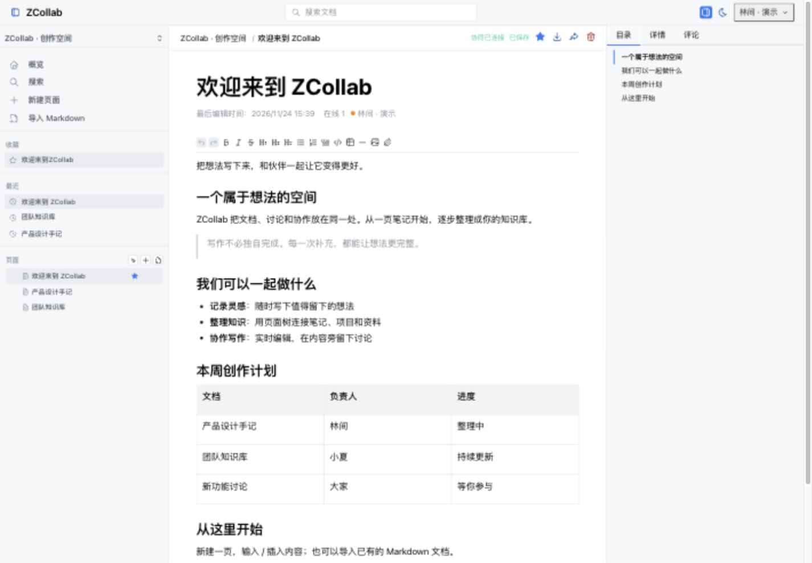
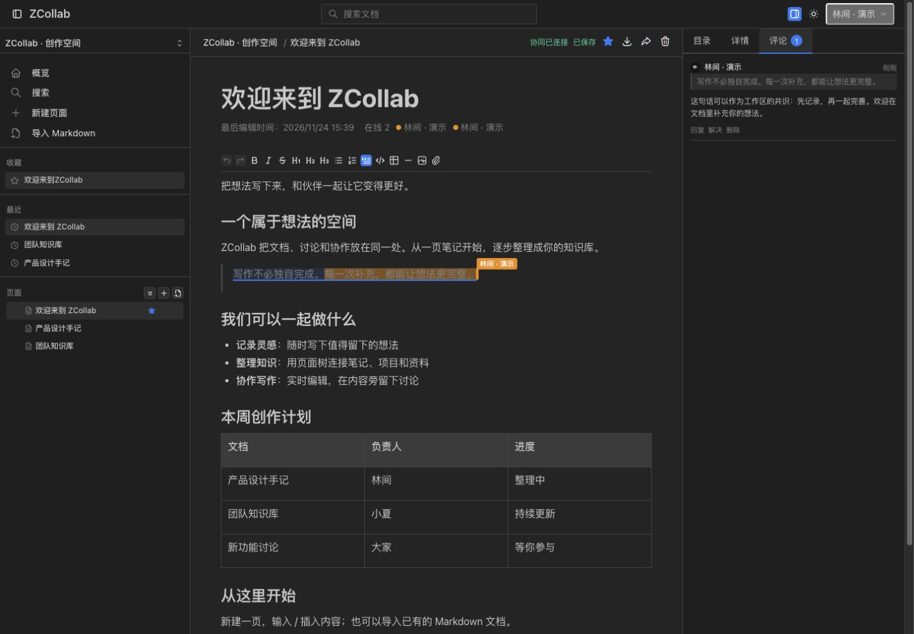
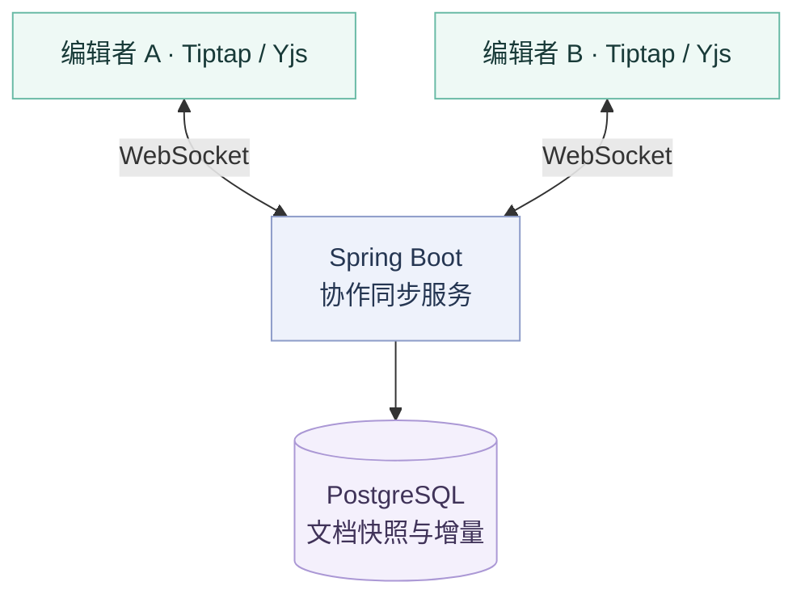

<p align="center">
  <a href="https://docs.zzzink.cn">
    <picture>
      <source media="(max-width: 640px)" srcset="./.github/assets/readme-cover-mobile.svg" />
      
    </picture>
  </a>
</p>

<p align="center">个人开发的在线文档协作项目，用来记录、整理，也用来一起写作。</p>

<p align="center">
  <a href="https://docs.zzzink.cn"><strong>在线体验 ↗</strong></a> ·
  <a href="#界面预览">界面预览</a> ·
  <a href="#在线体验">在线体验指南</a> ·
  <a href="#功能亮点">功能亮点</a> ·
  <a href="#技术实现">技术实现</a> ·
  <a href="https://github.com/zhoujiakang/ZCollab/issues">反馈与建议</a>
</p>

<p align="center">
  <a href="./LICENSE"></a>
  
  
  
  
</p>

---

## 界面预览

页面树、富文本编辑器与文档目录，在一个界面里完成整理和写作。



<p align="center"><sub>浅色主题 · 页面树、编辑器与目录大纲</sub></p>

## 在线体验

打开 **[docs.zzzink.cn](https://docs.zzzink.cn)**，可以这样开始：

1. **创建自己的空间**：注册账号，给工作区起个名字。
2. **写下第一份文档**：新建页面或选择模板，输入 `/` 插入内容，也可以导入已有的 Markdown。
3. **试试一起写**：邀请伙伴加入工作区，打开同一份文档，查看实时光标；选中文字，就能围绕内容发起评论。

## 功能亮点

### ✍️ 多人一起写

同时编辑同一份文档，实时查看彼此的光标与在线状态。选中文字就能发起评论，在对应的内容旁回复、讨论和标记解决。

### 🗂️ 从一页笔记到一个知识库

通过工作区与嵌套页面树整理内容，拖拽排序或移动文档。用全文搜索查找标题和正文，通过收藏与最近访问回到常用页面。

### 🧩 让写作顺手一些

- **内容编辑**：标题、列表、引用、代码高亮、表格、图片与附件，通过斜杠命令快速插入。
- **从模板开始**：会议记录、需求文档、周报、读书笔记，也能导入和导出 Markdown。
- **按习惯操作**：命令面板、快捷键速查表与明暗主题。

### 🔗 写完之后，分享出去

用公开链接分享一份文档，或通过邀请链接让其他人加入工作区，一起维护内容。

## 协作实景

把讨论留在内容旁边，编辑时也能看到其他协作窗口的选区与光标。



<p align="center"><sub>深色主题 · 同一演示账号的双窗口协作与评论<br />以上均为线上实际界面，文档与评论为展示用示例内容。</sub></p>

## 技术实现

**用 Java 对接 Yjs 协作协议**是这个项目的主要技术实践：前端使用标准 y-websocket 客户端，Spring Boot 后端处理同步消息、业务权限和文档持久化。

- **同步协议**：处理 Yjs 同步握手与增量消息，按文档房间广播变更，转发光标和在线状态。
- **持久化与恢复**：将二进制增量写入 PostgreSQL；新连接通过快照和后续增量重放恢复文档，快照收缩后清理已覆盖的增量。
- **访问校验**：协作连接校验登录态、工作区成员身份与文档归属，和业务接口使用同一套身份体系。

文档变更的合并由客户端 **Yjs** 完成，富文本编辑基于 **Tiptap**。



| 层次 | 技术选型 |
| --- | --- |
| 界面与交互 | React · TypeScript · Vite · Mantine · dnd-kit |
| 编辑与协作 | Tiptap · Yjs · y-websocket · lowlight |
| 业务与认证 | Spring Boot · MyBatis-Plus · Sa-Token |
| 数据存储 | PostgreSQL · Redis |

<details>
<summary>从哪里开始读源码？</summary>

- [文档编辑页面](./client/src/components/page/PageView.tsx)：编辑器、工具栏与协作能力的集成入口。
- [前端协作连接](./client/src/collab/useCollabDoc.ts)：Y.Doc、WebSocket 连接的生命周期与离开文档时的快照提交。
- [后端同步服务](./server/src/main/java/com/zcollab/ws/CollabSyncService.java)：同步握手、增量转发与在线状态广播。
- [文档持久化](./server/src/main/java/com/zcollab/store/PgDocStore.java)：快照、增量读写与快照覆盖后的增量清理。
- [协作访问校验](./server/src/main/java/com/zcollab/ws/CollabHandshakeInterceptor.java)：连接的登录态、工作区成员身份与文档归属检查。

```text
ZCollab
├── client/src/
│   ├── components/   编辑器、页面树、评论与应用布局
│   ├── collab/       Yjs 文档与 WebSocket 连接
│   ├── pages/        登录、工作区与设置页面
│   └── lib/          Markdown、模板与文档工具
├── server/
│   ├── src/main/     业务接口、协作协议与持久化实现
│   ├── src/test/     后端单元测试
│   └── sql/          数据库脚本
└── .github/assets/   README 封面与界面截图
```

</details>

## 交流与反馈

ZCollab 是我的个人开源项目，从编辑器、工作区到协作同步逐步实现，目前仍在持续完善。

欢迎通过 [Issues](https://github.com/zhoujiakang/ZCollab/issues) 反馈问题、分享使用感受，或提出想看到的功能。如果这个项目对你有帮助，也欢迎留一颗 Star。

项目基于 [MIT License](./LICENSE) 开源。

<p align="center">
  <sub>由 <a href="https://github.com/zhoujiakang">zhoujiakang</a> 开发 · <a href="https://docs.zzzink.cn">去写下第一个想法 ↗</a></sub>
</p>
