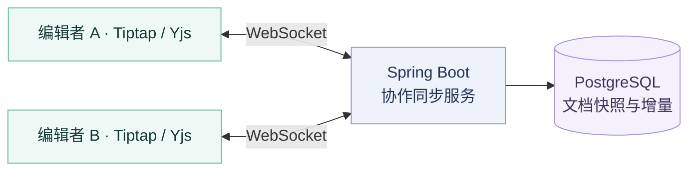

<p align="center">
  <a href="https://docs.zzzink.cn">
    
  </a>
</p>

<h1 align="center">ZCollab</h1>

<p align="center">
  一个个人开发的在线文档协作项目。<br />
  从一页笔记开始，把想法整理成文档，和其他人一起完善。
</p>

<p align="center">
  <a href="https://docs.zzzink.cn"><strong>在线体验 ↗</strong></a> ·
  <a href="#功能亮点">功能亮点</a> ·
  <a href="#技术实现">技术实现</a> ·
  <a href="https://github.com/zhoujiakang/ZCollab/issues">反馈与建议</a>
</p>

<p align="center">
  <a href="./LICENSE"></a>
  
  
  
  
</p>

---

## 关于这个项目

ZCollab 把文档编辑、内容整理和协作讨论放进同一个工作区。你可以用它记笔记、写需求、整理知识，也可以邀请其他人一起编辑，再通过链接把文档分享出去。

这是我的个人开源项目，从前端编辑器到后端协作同步逐步实现，目前仍在持续完善。欢迎到 **[docs.zzzink.cn](https://docs.zzzink.cn)** 体验。

## 功能亮点

<table>
  <tr>
    <td width="50%" valign="top">
      <h3>✍️ 多人一起写</h3>
      <p>多人同时编辑同一份文档，实时查看彼此的光标和在线状态，让修改在同一页中汇合。</p>
    </td>
    <td width="50%" valign="top">
      <h3>🗂️ 把文档组织起来</h3>
      <p>用工作区和嵌套页面树整理内容，支持拖拽排序、移动文档、收藏与最近访问。</p>
    </td>
  </tr>
  <tr>
    <td valign="top">
      <h3>💬 围绕内容讨论</h3>
      <p>选中文字发起评论，在文档旁回复和标记解决，让讨论留在对应的上下文里。</p>
    </td>
    <td valign="top">
      <h3>🔗 分享给更多人</h3>
      <p>通过公开链接分享文档，或用邀请链接让其他人加入工作区，继续一起完善内容。</p>
    </td>
  </tr>
</table>

### 写作时用得上的细节

| | 支持的能力 |
| --- | --- |
| **内容编辑** | 标题、列表、引用、代码高亮、表格、图片与附件 |
| **快速操作** | 斜杠命令、命令面板、快捷键与速查表 |
| **文档模板** | 会议记录、需求文档、周报、读书笔记等 |
| **内容查找** | 标题与正文全文搜索、收藏、最近访问 |
| **导入导出** | Markdown 导入与导出 |
| **界面偏好** | 明暗主题切换 |

## 技术实现

前端使用 **React + TypeScript**，以 **Tiptap** 为编辑器基础，结合 **Yjs** 实现协同编辑。后端使用 **Java 21 + Spring Boot**，负责业务接口、权限校验、WebSocket 同步转发和文档持久化。



Yjs 在客户端合并文档变更，后端转发同步消息与在线状态，并将快照和增量更新保存到 PostgreSQL。重新连接时，通过快照与增量重放恢复文档状态。

| 层次 | 技术选型 |
| --- | --- |
| 界面与交互 | React · TypeScript · Vite · Mantine · dnd-kit |
| 编辑与协作 | Tiptap · Yjs · y-websocket · lowlight |
| 业务与认证 | Spring Boot · MyBatis-Plus · Sa-Token |
| 数据存储 | PostgreSQL · Redis |

<details>
<summary>浏览源码结构</summary>

```text
ZCollab
├── client/src/
│   ├── components/   编辑器、页面树、评论与应用布局
│   ├── collab/       Yjs 文档与 WebSocket 连接
│   ├── pages/        登录、工作区与设置页面
│   └── lib/          Markdown、模板与文档工具
├── server/
│   ├── src/main/    业务接口、协作协议与持久化实现
│   ├── src/test/    后端单元测试
│   └── sql/         数据库脚本
└── docs/            项目文档与开发记录
```

</details>

## 交流与反馈

欢迎通过 [Issues](https://github.com/zhoujiakang/ZCollab/issues) 反馈问题、分享使用感受，或提出想看到的功能。如果这个项目对你有帮助，也欢迎留一颗 Star。

项目基于 [MIT License](./LICENSE) 开源。

<p align="center">
  <sub>由 <a href="https://github.com/zhoujiakang">zhoujiakang</a> 开发 · <a href="https://docs.zzzink.cn">去写下第一个想法 ↗</a></sub>
</p>
